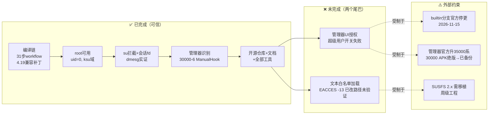
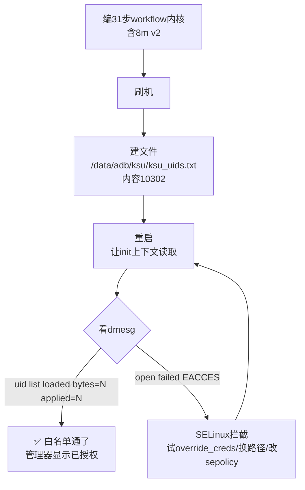

# 项目流程图（FLOW）

> 两张图：**总览** 与 **UI 授权攻坚路线**。配合 [HANDOVER.md](HANDOVER.md) 使用。

## 图 1：项目总览状态



## 图 2：UI 授权攻坚路线（阶段 0→3）

```mermaid
flowchart TD
    S[起点<br/>UI授权失败<br/>无SET_APP_PROFILE]<] --> P0
    P0["阶段0 静态分析<br/>JADX反编译30000管理器<br/>找10003/SET_APP_PROFILE<br/>守卫逻辑"] --> P1
    P1["阶段1 动态证据<br/>编8o内核 → 一键诊断<br/>ksu_f10003遍历1/2/3/MAX<br/>+strace +dmesg"] --> P2
    P2{"证据指向？"}
    P2 -- 10003数值不对 --> P2A["改默认值<br/>收工 🎉"]
    P2 -- 缺ioctl命令 --> P2B["dispatch.c补handler<br/>映射ksu_set_app_profile"]
    P2 -- 签名/包名校验 --> P2C["内核侧放行<br/>ksu_verify_manager_apk_signature"]
    P2 -- 全对仍不发 --> P2D["查sulog/事件通道"]
    P2A --> P2B
    P2B --> P3{"首攻结果"}
    P3 -- 失败 --> P4["阶段3 终招<br/>伪造版本号35106/41150<br/>或移植main协议面<br/>或改装管理器+签名白名单"]
    P3 -- 成功 --> DONE["✅ UI授权可用"]
    P4 --> DONE
```

## 图 3：白名单验证（接手者第一步）


